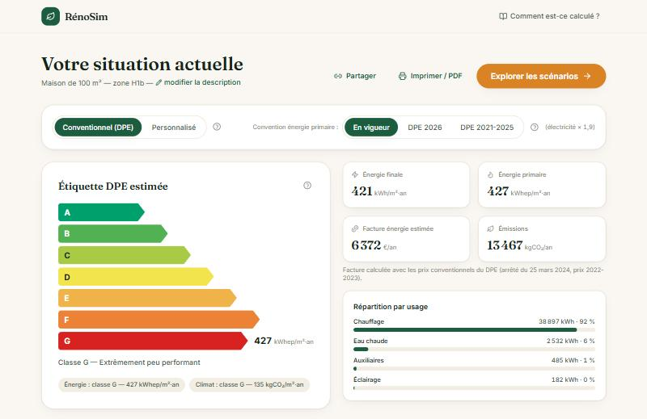
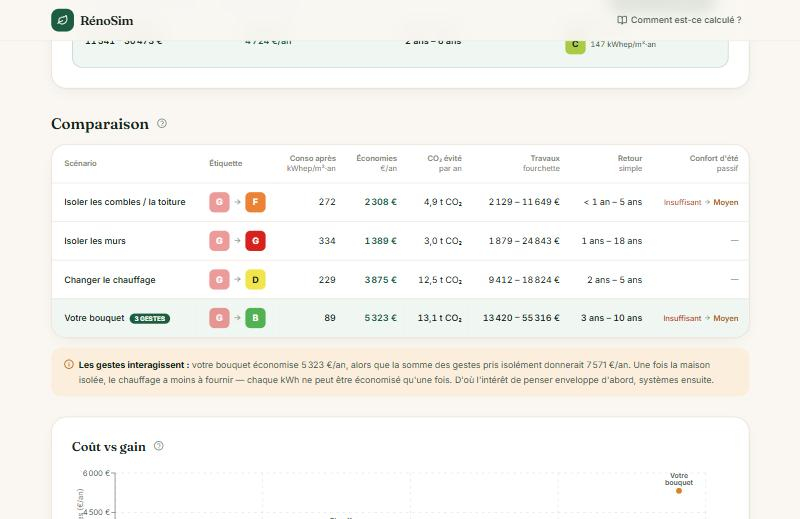
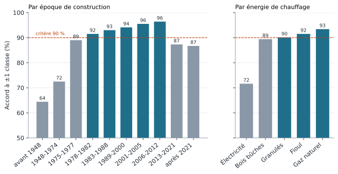

# RénoSim — Simulateur de rénovation énergétique résidentielle

[](https://github.com/quetinn/renosim/actions/workflows/ci.yml)
[](https://github.com/quetinn/renosim/actions/workflows/deploy.yml)
[](LICENSE)

**Démo en ligne : <https://quetinn.github.io/renosim/>** ·
[Note de validation](https://quetinn.github.io/renosim/validation/index.html) ·
[Écarts à la méthode officielle](docs/deviations.md)

**RénoSim** est un simulateur open-source de rénovation énergétique pour les logements
français. Vous décrivez votre maison en deux minutes. L'outil estime sa performance actuelle
(consommation, émissions de CO₂, étiquette DPE), puis chiffre des gestes de rénovation, seuls ou
en bouquets : coût des travaux en fourchette, économies annuelles, temps de retour, nouvelle
étiquette.

| Ma situation actuelle | Mes scénarios |
|---|---|
|  |  |

> 🛈 **Outil pédagogique** : RénoSim ne remplace ni un DPE officiel ni un audit énergétique.
> Pour un accompagnement réel et les aides financières : [France Rénov'](https://france-renov.gouv.fr).

## Ce qui distingue ce projet

1. **Un moteur physique**, pas un barème : une version simplifiée de la méthode réglementaire
   3CL-DPE 2021 (déperditions paroi par paroi, besoins mensuels par degrés-heures, rendements
   des systèmes, double étiquette énergie/climat). Python pur, typé, testé (205 tests,
   couverture 96 %). Chaque simplification est tracée dans [`docs/deviations.md`](docs/deviations.md).
2. **Une validation quantitative et honnête** contre la base ouverte des DPE de l'ADEME, avec un
   échantillon de test indépendant, des intervalles de confiance et une repondération selon le
   parc réel (voir ci-dessous).
3. **Aucun serveur** : le moteur Python s'exécute dans votre navigateur via
   [Pyodide](https://pyodide.org). Une seule implémentation du calcul, une application 100 %
   statique hébergée sur GitHub Pages. Vos données ne quittent jamais votre navigateur.
4. **Des tables sourcées** : chaque valeur réglementaire ou économique vit dans
   [`engine/renosim/tables/`](engine/renosim/tables) avec sa source et sa date (arrêtés DPE,
   annexe 1 de la méthode 3CL, prix conventionnels de l'arrêté du 25 mars 2024, indice INSEE BT01
   pour les coûts de travaux…).

## Validation contre la base DPE de l'ADEME

Le moteur, en mode conventionnel, est confronté aux diagnostics officiels de maisons
individuelles (jeu « DPE Logements existants depuis juillet 2021 », Licence Ouverte). Résultats
de la campagne v6 (note de validation v3, 26/11/2026) :

| | Calibration | **Test indépendant** | Test, DPE de la méthode en vigueur (v2.6) |
|---|---:|---:|---:|
| Logements | 11 625 | **11 496** | 1 885 |
| Accord à ±1 classe (critère : 90 %) | 90,3 % | **87,0 %** [86,4 ; 87,6] | **93,6 %** [92,4 ; 94,7] |
| Accord exact (critère : 60 %) | 50,0 % | **44,9 %** | 55,2 % |
| Biais moyen Cep (kWhep/m²/an) | +11,3 | **+33,3** | +2,3 |
| ±1 classe, repondéré selon le parc | 81,4 % | 71,7 % | 86,3 % |

*Intervalles de confiance à 95 % par bootstrap (1 000 tirages). Le test est un échantillon tiré
au hasard, disjoint de la calibration, et n'a jamais servi à régler le moteur.*

**Lecture.** Le critère fixé au départ (≥ 90 % à ±1 classe) est atteint sur les DPE établis avec
la version actuelle de la méthode, mais **pas sur l'ensemble du test** : les DPE de 2022-2025
sont surestimés d'environ 40 kWhep/m². Le moteur est fiable pour le gaz, le fioul et les maisons
de 1975 à 2012 (90 à 96 %) ; ses points faibles sont le **chauffage électrique** et le **bâti
d'avant 1975**, qui pèsent lourd dans le parc. Ces limites sont analysées dans la
[note de validation](validation/report/note_validation.md), avec le protocole annoncé pour la
prochaine calibration.



## Ce que fait l'outil

- **Logements** : maisons individuelles (cœur du projet et de la validation) et appartements
  traités logement par logement (modèle plus simple, validé séparément).
- **Deux modes** : conventionnel (scénario réglementaire, qui donne l'étiquette) et personnalisé
  (consigne, occupants, prix : agit sur les kWh, les euros et le CO₂, jamais sur l'étiquette).
- **Sept gestes** : isolation des combles, des murs, fenêtres, chauffage (PAC air-eau,
  chaudière gaz à condensation, poêle à granulés), eau chaude (chauffe-eau thermodynamique ou
  couplage), ventilation (hygroréglable, double flux), protections solaires pour l'été.
- **Bouquets** : trois bouquets types et des combinaisons libres, recalculés dans l'ordre
  enveloppe puis systèmes ; l'interface montre pourquoi les économies **ne s'additionnent pas**.
- **Viser une étiquette** : recherche du bouquet le moins cher qui atteint une classe donnée.
- **Puissance de chauffage** nécessaire par grand froid, et alerte quand une pompe à chaleur
  est installée sur une maison trop peu isolée pour la gamme de prix affichée.
- **Convention à jour** : coefficient d'énergie primaire de l'électricité selon le calendrier
  réglementaire (2,3 jusqu'en 2025, 1,9 en 2026, 1,7 à partir du 1er janvier 2027), seuils des
  petites surfaces, indicateur de confort d'été, refroidissement.
- **Partage et impression** : lien de partage (la description voyage dans l'URL, sans serveur)
  et rapport imprimable.

## Ce que cet outil n'est pas

- **Pas un DPE.** Il reproduit une version simplifiée de la méthode, à partir d'une description
  sommaire (la géométrie est reconstituée à partir de la surface). Son étiquette est une
  estimation, à ±1 classe dans environ 9 cas sur 10 pour une maison récente au gaz, moins
  souvent pour une maison ancienne chauffée à l'électricité.
- **Pas un audit énergétique** : pas de visite, pas de métrés, pas de préconisation adaptée au
  bâti réel (humidité des murs anciens, faisabilité technique…).
- **Pas une prédiction de facture** : le DPE est conventionnel ; votre consommation réelle
  dépend de vos usages. Le mode personnalisé en donne un ordre de grandeur.
- **Pas un calculateur d'aides** : MaPrimeRénov' et CEE ne sont volontairement pas calculés
  (lien France Rénov' uniquement).
- **Pas un devis** : les coûts sont des fourchettes publiques, actualisées par l'indice BT01.

## Architecture

```
Navigateur : App React (Vite, TypeScript)  ◄── JSON versionné ──►  Pyodide → package Python `renosim`
Développement : même package `renosim` + scripts de validation contre la base DPE ADEME
```

| Dossier | Contenu |
|---|---|
| [`engine/`](engine) | Le moteur `renosim` : Python ≥ 3.11, bibliothèque standard uniquement, wheel pure-Python |
| [`engine/renosim/tables/`](engine/renosim/tables) | Données réglementaires et économiques, chacune avec source et date |
| [`tests/`](tests) | Tests unitaires calculés à la main, cas de référence de bout en bout, invariants |
| [`validation/`](validation) | Téléchargement de l'échantillon, mapping ADEME → modèle, campagnes, figures, note |
| [`app/`](app) | Application web (Vite + React + TypeScript + Tailwind), déployée sur GitHub Pages |
| [`docs/`](docs) | Écarts à la 3CL, journal de bord, audit du 25/11/2026 |

## Démarrer

```bash
# Moteur
python -m venv .venv && source .venv/bin/activate   # Windows : .venv\Scripts\activate
pip install -e "engine[dev]"
pytest                                   # 205 tests, couverture ≥ 85 % exigée
ruff check . && ruff format --check . && mypy

# Application (le wheel du moteur est chargé par Pyodide)
cd app
npm install
npm run wheel     # construit le wheel renosim et son manifeste dans app/public/wheels/
npm run dev       # http://localhost:5173
```

Exemples d'utilisation du moteur en Python : [`tests/test_reference_cases.py`](tests/test_reference_cases.py)
et les notebooks de [`validation/notebooks/`](validation/notebooks).

### Reproduire la validation

Les données ADEME brutes ne sont jamais versionnées : les scripts les retéléchargent par l'API
publique (quelques minutes). Les commandes exactes de chaque campagne sont au §8 de la
[note de validation](validation/report/note_validation.md#8-reproductibilité). Les figures et la
page HTML de la note se régénèrent à partir des seuls fichiers de résultats versionnés :

```bash
pip install -r validation/requirements.txt
python validation/make_figures.py
quarto render validation/report
```

## Feuille de route

- [x] **Phase 0** — Structure du dépôt, intégration continue, déploiement
- [x] **Phase 1** — Moteur : enveloppe, besoins, systèmes, étiquettes, deux modes
- [x] **Phase 2** — Gestes de rénovation, bouquets, coûts et temps de retour
- [x] **Phase 3** — Validation contre la base DPE ADEME, note technique
- [x] **Phase 4** — Application React + Pyodide : parcours guidé, situation, scénarios, panneau
      « Comment est-ce calculé ? »
- [x] **Phase 5** — Consolidation : audit du 25/11/2026, prix et convention à jour, échantillon
      de test indépendant, note de validation finale, documentation

**v1.1 « conformité réglementaire »** (une seule recalibration à la fin, selon le protocole annoncé
dans la note) : ponts thermiques par liaison et distinction ITE/ITI, matériau des murs anciens,
inertie selon les règles Th-I, volets en hiver (Ujn), chaudières bois et ECS des PAC selon la
méthode, appoint des PAC et coût selon la puissance (la puissance nécessaire et l'alerte « isolez
d'abord » sont déjà en place), geste « plancher bas », alertes sur les
performances minimales de la réglementation thermique des bâtiments existants.

**Plus tard** : étiquette probabiliste (Monte-Carlo sur les entrées inconnues), carbone gris des
travaux, parcours par étapes de type audit réglementaire, validation contre des consommations
réelles. Hors périmètre : DPE à l'immeuble, calcul des aides, photovoltaïque, VAN/TRI.

## Licence et données

Code sous licence [MIT](LICENSE) — © 2026 Noé Quetin. Données DPE : ADEME, Licence Ouverte v2.0
(seuls des agrégats sont versionnés). Les textes réglementaires sont cités avec leur référence ;
aucun document sous droits (CSTB) ni fichier météo RE2020 n'est redistribué.

Projet personnel réalisé dans le cadre d'une spécialisation en énergies renouvelables et
efficacité énergétique.
