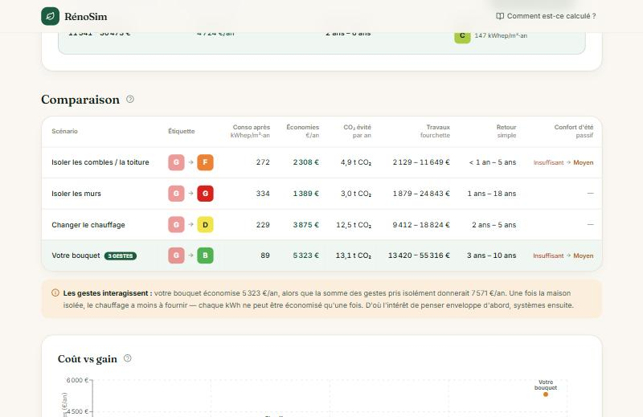
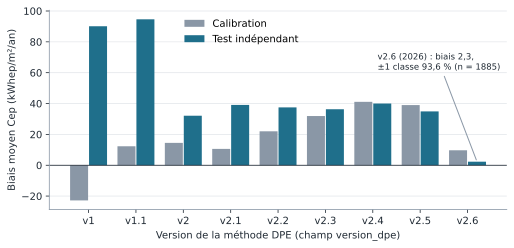

<!--
Brouillon pour le site personnel (thème al-folio). À copier dans _posts/ ; copier aussi les
images de docs/img/ et validation/report/figures/ dans assets/img/renosim/ et adapter les chemins
si l'on préfère ne pas pointer vers GitHub.
-->

**En bref.** [RénoSim](https://quetinn.github.io/renosim/) estime l'étiquette DPE d'un logement à
partir d'une description de deux minutes, puis chiffre des gestes de rénovation : coût, économies,
temps de retour, nouvelle étiquette. Le calcul suit une version simplifiée de la méthode
réglementaire 3CL-DPE 2021. Il est écrit en Python et s'exécute **dans le navigateur**. Je l'ai
confronté à plus de 23 000 diagnostics officiels. Le code est
[sur GitHub](https://github.com/quetinn/renosim).

## Pourquoi un énième simulateur ?

Les simulateurs grand public répondent en général à partir de barèmes : « maison des années 70,
fioul → classe F ». Ils ne disent ni d'où vient la chaleur perdue, ni pourquoi isoler puis changer
de chauffage ne rapporte pas la somme des deux gestes. Je voulais un outil qui **calcule** :
déperditions paroi par paroi, besoins mensuels par degrés-heures, rendements des systèmes selon
leur âge, double seuil énergie/climat de l'étiquette. Et surtout un outil dont on puisse
**mesurer** l'écart à la méthode officielle, plutôt que de le supposer petit.

## Un seul moteur, zéro serveur

Le moteur (`renosim`) est un package Python sans dépendance : bibliothèque standard uniquement,
tables réglementaires en JSON, chacune avec sa source et sa date. Cette contrainte a un but :
le même wheel sert aux scripts de validation sur mon ordinateur **et** à l'application web, où
[Pyodide](https://pyodide.org) l'exécute dans le navigateur. Il n'y a donc qu'une implémentation
du calcul, et aucune donnée saisie ne quitte la machine de l'utilisateur.

L'interface (React, TypeScript) ne fait que trois choses : collecter les réponses, sérialiser un
JSON versionné, afficher ce que le moteur renvoie. Pyodide met quelques secondes à charger : il
démarre dès l'arrivée sur la page, pendant que l'utilisateur remplit le formulaire.

## Valider contre la base DPE de l'ADEME

L'ADEME publie tous les DPE réalisés depuis juillet 2021. C'est un terrain de validation idéal :
pour chaque logement, on dispose des caractéristiques déclarées par le diagnostiqueur **et** du
résultat officiel. J'ai écrit un mapping des champs ADEME vers le modèle du moteur (la partie la
plus délicate : champs hétérogènes, parfois vides), puis comparé les étiquettes.

Le critère fixé au départ était exigeant : 60 % d'étiquettes exactes et 90 % à ±1 classe.

### Première version : critère atteint… sur le mauvais échantillon

En juillet, après six itérations de calibration documentées, le moteur atteignait 90,8 % à
±1 classe. J'avais déclaré le critère atteint.

En reprenant le projet en novembre, un audit méthodologique a pointé le problème évident :
**l'échantillon qui avait servi à régler le moteur était aussi celui qui servait à l'évaluer.**
J'ai donc tiré au hasard un second échantillon, disjoint du premier, de 11 496 maisons, sur lequel
rien n'a été réglé. Résultat : **87,0 % à ±1 classe**. Le critère n'est pas atteint sur données
indépendantes.

### Comprendre l'écart plutôt que le masquer

L'écart n'était pas uniforme. Ventilé par année, il apparaissait concentré sur les DPE de 2022 à
2025, surestimés d'environ 40 kWhep/m². En récupérant la version de méthode de chaque DPE, la
rupture devient nette : elle suit la **version des logiciels de diagnostic**. Les DPE de la
version en vigueur (2026) sont reproduits à **93,6 %** à ±1 classe, avec un biais de 2 kWhep/m².
Or l'échantillon de calibration de juillet, tiré « dans l'ordre » du jeu de données, contenait
61 % de DPE de 2026.

L'analyse poste par poste a aussi révélé une vraie erreur : l'éclairage était surestimé de 41 %
dans toutes les versions, parce que j'utilisais une durée annuelle unique au lieu du tableau
mensuel par zone climatique de la méthode. Corrigée, elle colle désormais au DPE à moins de 1 % près.

Restent deux faiblesses réelles, indépendantes de la version : le **chauffage électrique** et le
**bâti d'avant 1975**. Une fois les résultats repondérés selon le parc réel, où ces deux segments
pèsent lourd, l'accord tombe à 72 %. C'est la priorité de la prochaine version : ponts thermiques
par liaison, matériau des murs anciens, inertie selon les règles Th-I.

### Ce que j'en retiens

- **Séparer calibration et test dès le départ**, même sur un projet personnel : un chiffre
  flatteur mesuré sur l'échantillon d'apprentissage ne vaut rien.
- **Annoncer le protocole avant de recalibrer.** La note de validation fixe maintenant la
  référence (DPE de la méthode en vigueur), l'échantillon et les critères de la prochaine mesure,
  avant de l'avoir faite.
- **Ventiler les erreurs jusqu'à trouver une variable qui les explique.** Ici, la version des
  logiciels, une information qui n'était même pas dans mon échantillon de départ.
- **Publier aussi ce qui ne marche pas.** La note de validation détaille les segments où le
  moteur se trompe ; c'est ce qui la rend utile.

## Et après ?

La v1.1 portera sur la conformité réglementaire (ponts thermiques, murs anciens, volets en hiver,
pompes à chaleur dimensionnées), suivie d'une seule recalibration selon le protocole annoncé.
Plus loin : une **étiquette probabiliste**, qui propage l'incertitude des réponses « je ne sais
pas » (« E à 60 %, D à 30 % »), et une comparaison avec des consommations réelles, pour mesurer
l'écart entre DPE conventionnel et usage.

*RénoSim est un outil pédagogique : il ne remplace ni un DPE officiel ni un audit énergétique.*

- Application : <https://quetinn.github.io/renosim/>
- Note de validation : <https://quetinn.github.io/renosim/validation/index.html>
- Code : <https://github.com/quetinn/renosim>
